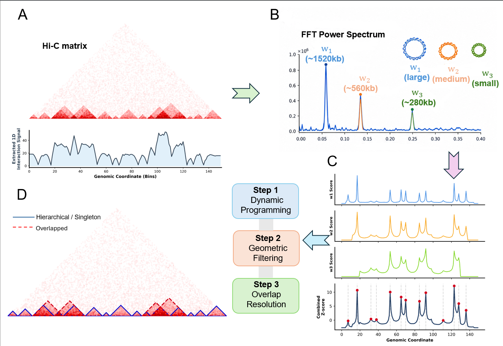

# TAD-X: FFT-based identification of complex topologically associating domains

TAD-X is an advanced computational framework that fundamentally shifts the paradigm of 3D genome analysis from single-scale, mutually exclusive clustering to multiscale, intersecting domain inference. By leveraging **Fast Fourier Transform (FFT)-based spectral analysis**, TAD-X autonomously extracts intrinsic chromatin folding scales directly from Hi-C contact maps—eliminating the need for predefined empirical window sizes. Coupled with explicit geometric constraints and exact dynamic programming, TAD-X systematically resolves heterogeneous chromatin architectures, including **Singleton**, **Hierarchical**, and **Overlapped** domains, providing a powerful lens to explore the structural basis of spatial gene regulation and genomic instability.



## 📂 Repository Structure

The repository is kept ultra-lightweight and highly integrated.

```text
TAD-X/
├── tad_x.py                           # Core algorithm: FFT scale discovery & DP inference
├── run_tadx.py                        # Main CLI for calling TAD-X on Hi-C matrices
├── downstream/                        # Modules for downstream evaluation & visualization
│   ├── eval_oos.py                    # 5-fold cross-validation for Information Gain (ΔLL)
│   └── plot_protein_enrichment.py     # ChIP-seq protein signal aggregation at boundaries
├── DATA/                              # Toy datasets for tutorials
│   ├── chr7_50kb_KR.npz               # Subset Hi-C matrix (chr7, K562 cell line)
│   └── chr7_CTCF_K562.bigWig          # Subset CTCF ChIP-seq signal for chr7
├── requirements.txt                   # Python dependencies
└── README.md
```

## ⚙️ Requirements

TAD-X is built on standard scientific computing libraries. We recommend using Python 3.8 or higher.

```bash
# Clone the repository
git clone [https://github.com/YourUsername/TAD-X.git](https://github.com/YourUsername/TAD-X.git)
cd TAD-X

# Install dependencies
pip install -r requirements.txt
```

* Key dependencies: numpy, scipy, pandas, scikit-learn, matplotlib, seaborn, pyBigWig

## 🚀 Quick Start (Tutorial)

We provide a highly streamlined, three-step pipeline using the toy dataset (chr7 of K562 cells at 50kb resolution) included in the DATA/ folder.

### Step 1: Infer TADs from Hi-C Data
Use run_tadx.py to identify complex topologies from your normalized Hi-C matrix. The tool operates completely autonomously without requiring hyperparameters like K or window_size.

```bash
python run_tadx.py \
    --matrix DATA/chr7_50kb_KR.npz \
    --chrom chr7 \
    --res 50000 \
    --out_bed chr7_TAD_X_domains.bed
```

### Step 2: Evaluate Out-of-Sample Information Gain (Optional)
To quantify the statistical goodness-of-fit and generalizability of the identified TADs, run the Out-of-Sample (OOS) evaluation script. This module uses 5-fold cross-validation to assess how well the topological architecture explains global interaction patterns ($\Delta$ Log-likelihood).

```bash
python downstream/eval_oos.py \
    --matrix DATA/chr7_50kb_KR.npz \
    --bed chr7_TAD_X_domains.bed \
    --res 50000 \
    --max_dist 40
```

### Step 3: Biological Validation via Protein Enrichment (Optional)
Verify the biological relevance of the inferred boundaries by calculating the spatial enrichment of architectural proteins (e.g., CTCF).(Note: A subset of CTCF ChIP-seq signal for chr7 is provided in the DATA/ folder for testing).

```bash
python downstream/plot_protein_enrichment.py \
    --bed chr7_TAD_X_domains.bed \
    --bw DATA/chr7_CTCF_K562.bigWig \
    --protein CTCF \
    --out_img TAD_X_CTCF_Enrichment.pdf
```

## 📊 Output format

TAD-X outputs the inferred domains in a standard, universally compatible BED format (without headers) containing three columns:

```text
Column 1 (Chromosome)    Column 2 (Start bp)     Column 3 (End bp)  
chr7                      1000000                 1850000
chr7                      1250000                 2500000
...
```
Note: TAD-X inherently preserves intersecting and nested intervals. Overlapping domains will appear as distinct intersecting rows in the BED file.

## 📖 Citation

If you use CHORD in your research, please cite our paper:

## ✉️ Contact
For any questions, bug reports, or feature requests, please open an issue on GitHub. email: zhaoling2-c@my.cityu.edu.hk
